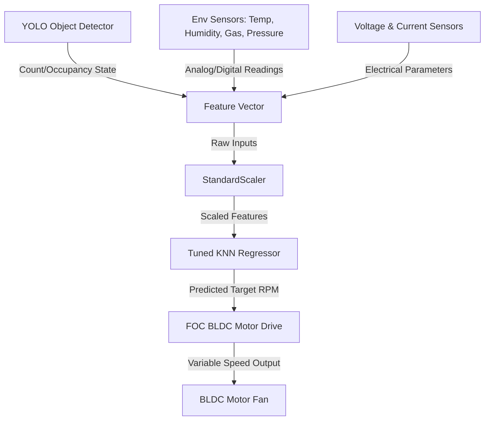

# FOC-Based BLDC Motor Speed Prediction Drive for Shopping Malls

This repository contains the intelligence and prediction framework for a Field-Oriented Control (FOC) based BLDC (Brushless DC) motor drive designed for public complexes, such as shopping malls. The system automatically adjusts the HVAC fan/motor speed according to environmental conditions and occupancy.

---

## 🎯 Project Aim & Concept

In large public spaces like shopping malls, energy consumption from air circulation and HVAC systems is extremely high. This project aims to optimize energy usage and maintain comfort levels by dynamically regulating a BLDC motor drive using a dual-AI approach:

1. **Occupancy Detection (YOLO)**: A computer vision camera stream uses a YOLO (You Only Look Once) model to monitor the complex and detect human occupancy (density/count), determining whether the area is active or empty.
2. **Dynamic Speed Prediction (KNN Regression)**: A K-Nearest Neighbors (KNN) model takes real-time readings—Occupancy, Temperature, Humidity, Pressure, Gas Levels, and feed-forward Voltage/Current—to predict the optimal fan/motor speed in RPM.
3. **Efficient Motor Drive (FOC)**: Field-Oriented Control (FOC) is utilized to drive the BLDC motor at the predicted RPM. FOC ensures high efficiency, low noise, smooth torque, and reduced power losses compared to traditional scalar control methods.

---

## 🛠️ System Architecture



---

## 📁 Repository Structure

* [BLDC_KNN_Dataset.xlsx](file:///c:/rishwan/Projects/foc_speed_prediction/BLDC_KNN_Dataset.xlsx): The Excel dataset containing training parameters and their corresponding actual motor speed (RPM).
* [train_knn.py](file:///c:/rishwan/Projects/foc_speed_prediction/train_knn.py): Script to load dataset, split data, apply `StandardScaler`, perform Grid Search optimization for hyperparameter tuning (`n_neighbors`, distance metrics, weights), evaluate the model, and save checkpoints.
* [predict.py](file:///c:/rishwan/Projects/foc_speed_prediction/predict.py): Command Line Interface (CLI) and interactive program that uses the trained scaler and model to predict the motor RPM for any given environment scenario.
* [person_detector.py](file:///c:/rishwan/Projects/foc_speed_prediction/person_detector.py): Computer vision occupancy detection script using YOLOv8 to count people in real time from a webcam or video stream, and dynamically feed the occupancy count to the KNN motor speed predictor.
* [simulate_realtime.py](file:///c:/rishwan/Projects/foc_speed_prediction/simulate_realtime.py): Real-time environment and occupancy stream simulator that tests the FOC BLDC drive under realistic mall conditions (morning lull, rush hour, gas spikes, random walk).
* [knn_model.joblib](file:///c:/rishwan/Projects/foc_speed_prediction/knn_model.joblib): Saved KNeighborsRegressor model checkpoint.
* [scaler.joblib](file:///c:/rishwan/Projects/foc_speed_prediction/scaler.joblib): Saved StandardScaler object checkpoint.
* [knn_performance.png](file:///c:/rishwan/Projects/foc_speed_prediction/knn_performance.png): Saved matplotlib plot comparing the actual vs. predicted fan speed (RPM) for evaluation.

---

## ⚙️ Setup & Installation

Ensure you have Python installed, then install the required dependencies:

```bash
pip install pandas numpy scikit-learn openpyxl matplotlib seaborn joblib opencv-python ultralytics
```

---

## 🚀 Running the Project

### 1. Training the KNN Model

To train the KNN model and optimize hyperparameters using cross-validation:

```bash
python train_knn.py
```

This script will:
* Load the Excel dataset.
* Tune hyperparameters using GridSearchCV.
* Report evaluation metrics: R² score, Mean Absolute Error (MAE), and Root Mean Squared Error (RMSE).
* Save the trained model to [knn_model.joblib](file:///c:/rishwan/Projects/foc_speed_prediction/knn_model.joblib) and scaler to [scaler.joblib](file:///c:/rishwan/Projects/foc_speed_prediction/scaler.joblib).
* Generate and save a prediction validation plot to [knn_performance.png](file:///c:/rishwan/Projects/foc_speed_prediction/knn_performance.png).

### 2. Predict Motor Speed (RPM)

You can run predictions on new sensor values using the [predict.py](file:///c:/rishwan/Projects/foc_speed_prediction/predict.py) script in three different modes:

#### A. Interactive Mode (Prompt-based Inputs)
Input the values through terminal prompts:
```bash
python predict.py --interactive
```

#### B. Command Line Argument Mode
Provide all features directly in the command line:
```bash
python predict.py --temp 32.5 --humidity 45.0 --gas 110.0 --pressure 1013.25 --occupancy 1.0 --voltage 12.0 --current 2.5
```

#### C. Sample Prediction (Default Demo)
Run without any argument to execute using default pre-configured test parameters:
```bash
python predict.py
```

### 3. Real-Time Occupancy Detection & Custom Video Validation (`person_detector.py`)

Run the computer vision script [person_detector.py](file:///c:/rishwan/Projects/foc_speed_prediction/person_detector.py) to count people from a live webcam or a custom video file, validate detection performance, and stream occupancy into the motor simulator:

#### A. Custom Video Validation:
Validate YOLO performance on your own recorded mall/surveillance video files:
```bash
python person_detector.py --video path/to/mall_cctv.mp4
```
* **Performance Validation Metrics**: Automatically calculates processing FPS vs native video FPS, progress percentage, occupancy range (min/max/mean), and motor speed predictions.
* **Playback Speed Control**: Real-time FPS sync is enabled by default. Use `--speed 1.5` for accelerated playback, or `--no-sync-fps` (`--fast`) for maximum benchmark inference speed.
* **Looping & Controls**: Use `--loop` for continuous testing. In the video window, press `SPACE` to pause/resume, `r` to rewind, `d` to toggle HUD, and `q` or `ESC` to stop and view the final validation report.

#### B. Pass Video Data Directly to `simulate_realtime.py` (In-Stream Simulation):
Feed detected occupancy from the video straight into the sensor drift & FOC motor speed simulation dashboard:
```bash
python person_detector.py --video mall_cctv.mp4 --simulate
```
You can also specify mall environment presets and save simulation outputs:
```bash
python person_detector.py --video mall_cctv.mp4 --simulate --sim-scenario afternoon_crowd --sim-log video_sim_log.csv
```

#### C. Live Webcam Stream:
```bash
python person_detector.py --source 0
```

---

### 4. Real-Time Environment Simulator (`simulate_realtime.py`)

Simulate dynamic shopping mall conditions with realistic sensor drift and time-series fluctuations:

#### Run Simulation Directly Driven by Video:
```bash
python simulate_realtime.py --video mall_cctv.mp4
```

#### Listen to Live Stream from `person_detector.py` (Dual-Terminal IPC Mode):
In Terminal 1 (Detector):
```bash
python person_detector.py --video mall_cctv.mp4
```
In Terminal 2 (Simulator):
```bash
python simulate_realtime.py --live
```
`simulate_realtime.py` will automatically pick up live occupancy updates published by `person_detector.py` via `.live_occupancy.json`.

#### Continuous Synthetic Simulation (Live Sensor Drift Dashboard):
```bash
python simulate_realtime.py --interval 1.0
```

#### Test Mall Specific Presets:
* **Empty Morning / Low Load:**
  ```bash
  python simulate_realtime.py --scenario morning_empty
  ```
* **Crowded Afternoon Rush / High Load:**
  ```bash
  python simulate_realtime.py --scenario afternoon_crowd
  ```
* **Food Court Cooking Spike:**
  ```bash
  python simulate_realtime.py --scenario food_court_smoke
  ```

#### Quick Batch Test of Random Scenarios:
```bash
python simulate_realtime.py --batch 10
```

#### Log Simulation to CSV:
```bash
python simulate_realtime.py --interval 1.0 --steps 50 --log sim_log.csv
```

---

## 📊 Features & Model Inputs

The KNN model expects the following features in order:

| Feature Name | Description | Unit |
| :--- | :--- | :--- |
| `Temperature_C` | Ambient complex temperature | Degrees Celsius (°C) |
| `Humidity_percent` | Ambient humidity levels | Percentage (%) |
| `Gas_ppm` | Gas concentration in the environment | Parts Per Million (ppm) |
| `Pressure_hPa` | Barometric atmospheric pressure | Hectopascals (hPa) |
| `Occupancy` | Number of persons detected (from YOLO vision stream) | Count (0 to 10+) |
| `Voltage_V` | Motor feed-forward voltage sensor reading | Volts (V) |
| `Current_A` | Motor feed-forward current sensor reading | Amperes (A) |

**Target Output:** `MotorSpeed_RPM` — Predicted target rotational speed for the BLDC motor controller.
